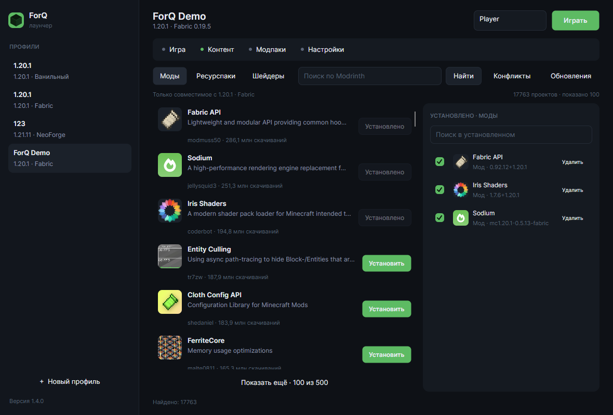
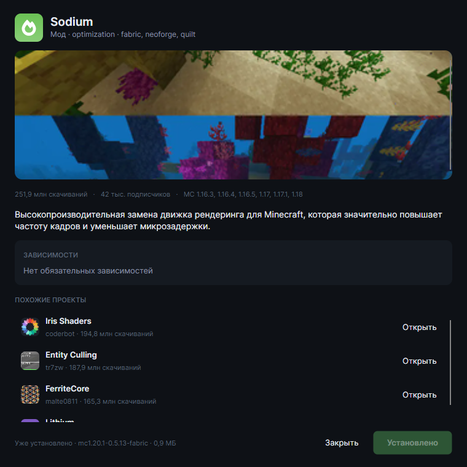
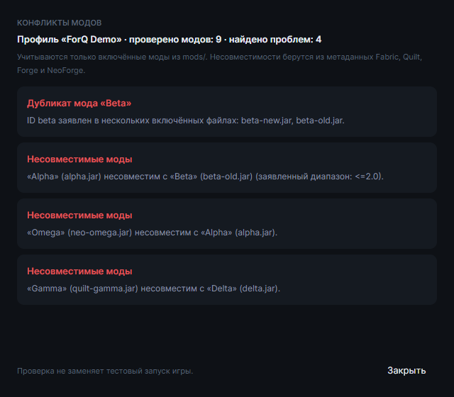
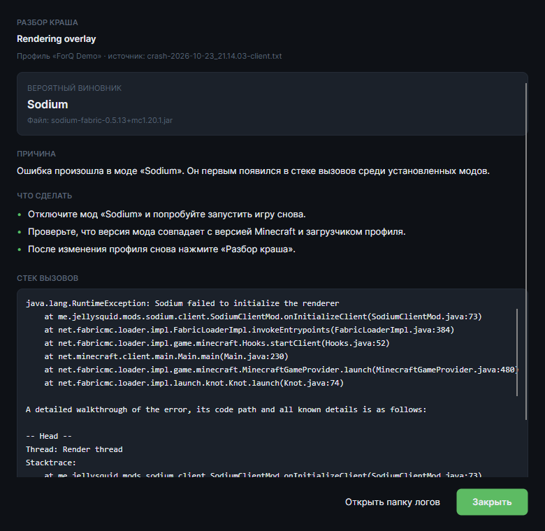
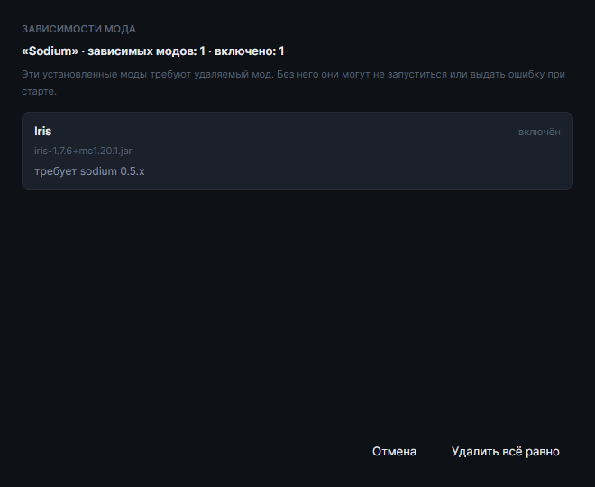
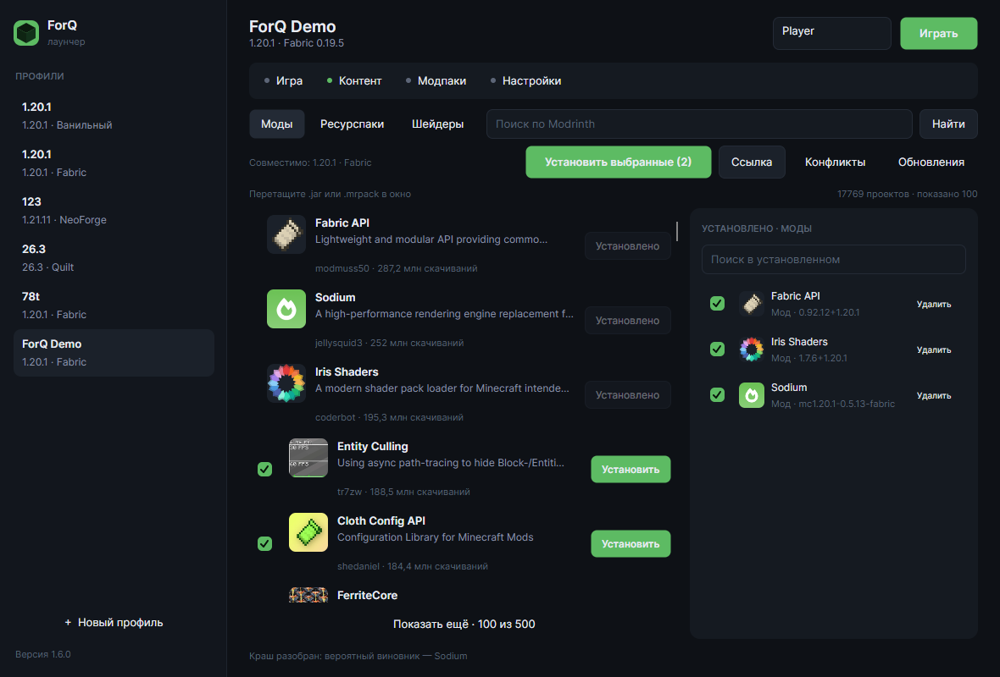
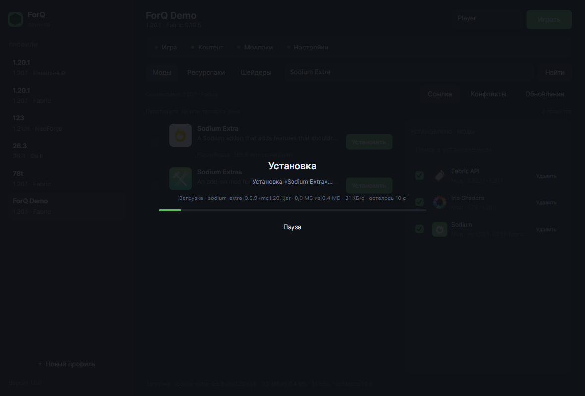

# ForQ Launcher

Лаунчер Minecraft для Windows с офлайн-входом и установкой контента с Modrinth. Запускается без установки, .NET уже внутри.

[**Скачать последнюю версию**](https://github.com/kirillsql1kaa11/ForQLauncher/releases/latest) · [Все релизы](https://github.com/kirillsql1kaa11/ForQLauncher/releases) · [Сообщить о проблеме](https://github.com/kirillsql1kaa11/ForQLauncher/issues)



## Что нового

- **1.7.0:** добавил вкладку «Что нового», каналы версий и закрепление модов, импорт `.mrpack` в существующий профиль, несколько ников, окно настроек профиля, улучшенный журнал и галерею скриншотов.
- **1.6.1:** добавил перевод описаний модов, шейдеров, ресурспаков и модпаков на русский — названия остаются на английском.
- **1.6.0:** добавил разбор крашей, пакетную установку, защиту зависимостей и менеджер загрузок.
- **1.5.0:** убрал настройку GitHub-токена — обновления проверяются без авторизации.
- **1.4.0:** добавил поиск по установленному, проверку конфликтов и открытие карточки по клику.

## Возможности

- Профили Minecraft с разными версиями и загрузчиками.
- Версии из официального манифеста Mojang; 1.20.1, 1.16.5 и 1.12.2 проверены с модами.
- Поддержка Fabric, Quilt и NeoForge.
- Офлайн-вход по локальному нику, без аккаунта Microsoft; несколько ников на профиль с переключением в шапке.
- Отдельное окно настроек профиля: название, память, разрешение и ники.
- Поиск и установка модов, ресурспаков, шейдеров и модпаков `.mrpack` с Modrinth.
- Русские описания в карточках и карточке проекта; названия проектов остаются на английском.
- Галерея скриншотов Modrinth в карточке проекта.
- Пакетная установка нескольких модов и импорт `.jar`, `.zip` и `.mrpack` перетаскиванием.
- Импорт `.mrpack` как в новый профиль, так и в текущий.
- Установка проектов и файлов по прямой ссылке.
- Отметки «Установлено», удаление и отключение контента.
- Каналы версий для каждого проекта: только стабильные, стабильные и бета или все версии.
- Закрепление версии мода: обновления не трогают закреплённые файлы.
- Предупреждение о зависимых модах перед удалением.
- Разбор `latest.log` и `crash-reports`: лаунчер находит вероятный мод и объясняет причину падения.
- Проверка обновлений установленных проектов.
- Проверка дубликатов и несовместимостей модов.
- Менеджер загрузок с паузой, продолжением, лимитом скорости, ETA и текущим файлом.
- Журнал с фильтрами, подсветкой ошибок и модов, копированием, сохранением в файл и ротацией по запускам.
- Пустые состояния с подсказками в поиске, установленном контенте, модпаках и списке профилей.
- Вкладка «Что нового» с журналом релизов и ссылкой на GitHub.
- Автоматическая загрузка Java, библиотек и ресурсов игры.
- Настройки памяти, разрешения экрана и количества потоков загрузки.
- Автообновление лаунчера без GitHub-токена.

## Скриншоты

| Карточка проекта | Проверка конфликтов |
|:---:|:---:|
| [](docs/screenshots/details.png) | [](docs/screenshots/conflicts.png) |

| Разбор краша | Защита зависимостей |
|:---:|:---:|
| [](docs/screenshots/crash.png) | [](docs/screenshots/dependents.png) |

| Пакетная установка | Менеджер загрузок |
|:---:|:---:|
| [](docs/screenshots/batch.png) | [](docs/screenshots/downloads.png) |

## Быстрый старт

1. Скачайте файл `ForQLauncher-*-win-x64.exe` со страницы [последнего релиза](https://github.com/kirillsql1kaa11/ForQLauncher/releases/latest).
2. Запустите его. Установка не требуется. Если Windows покажет SmartScreen, нажмите «Подробнее» → «Выполнить в любом случае».
3. Создайте профиль: укажите название, версию Minecraft и загрузчик.
4. Нажмите «Установить игру», дождитесь загрузки и запускайте.

## Требования

- Windows 10 или Windows 11, 64-бит.
- Интернет для загрузки игры и контента с Modrinth.
- Около 2 ГБ свободного места на один профиль с модами.
- .NET и Java отдельно устанавливать не нужно: лаунчер скачает Java автоматически.

## Где хранятся данные

Профили, настройки, Java, библиотеки, ресурсы и установленный контент находятся в:

```text
%APPDATA%\ForQLauncher
```

Чтобы удалить лаунчер вместе с профилями, закройте его и удалите эту папку.

## Сборка из исходников

Понадобится [.NET SDK 8.0](https://dotnet.microsoft.com/download) или новее.

```powershell
git clone https://github.com/kirillsql1kaa11/ForQLauncher.git
cd ForQLauncher
dotnet publish src\ForQ.App\ForQ.App.csproj -c Release -r win-x64 --self-contained true -o publish
```

Готовый файл появится в `publish\ForQ.App.exe`.

Структура проекта:

- `src/ForQ.App` — интерфейс на Avalonia.
- `src/ForQ.Core` — работа с Mojang и Modrinth, установка, обновления и проверка конфликтов.

## Обратная связь

Нашли ошибку или хотите предложить улучшение — создайте [issue](https://github.com/kirillsql1kaa11/ForQLauncher/issues). При ошибке приложите версию лаунчера, текст сообщения и шаги, которые к ней привели.

---

ForQ Launcher — неофициальный проект. Не связан с Mojang Studios или Microsoft. Minecraft является товарным знаком Mojang Studios.
